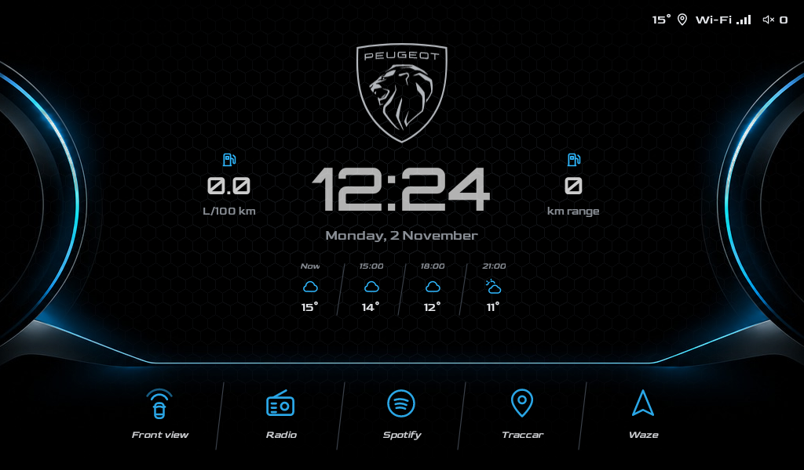
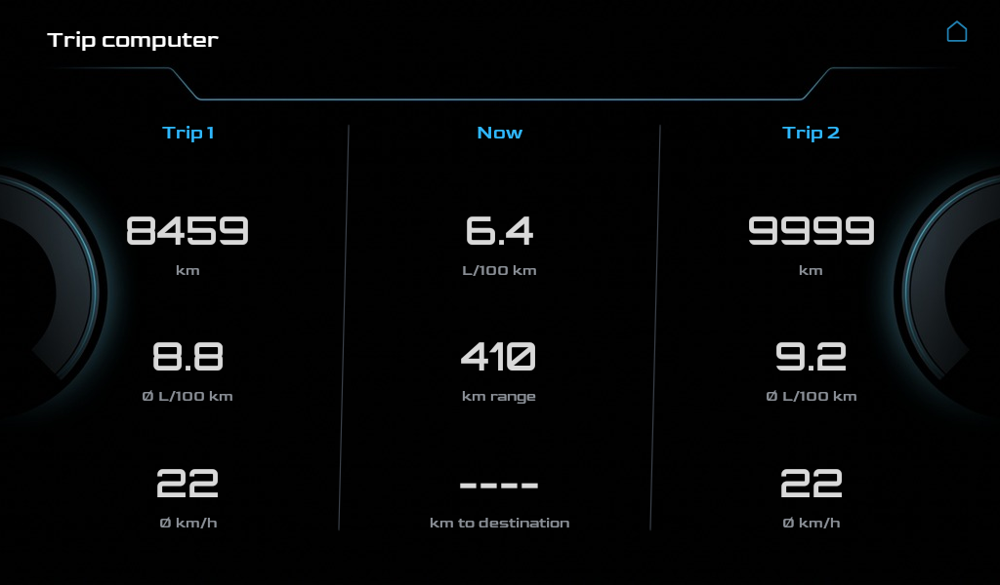
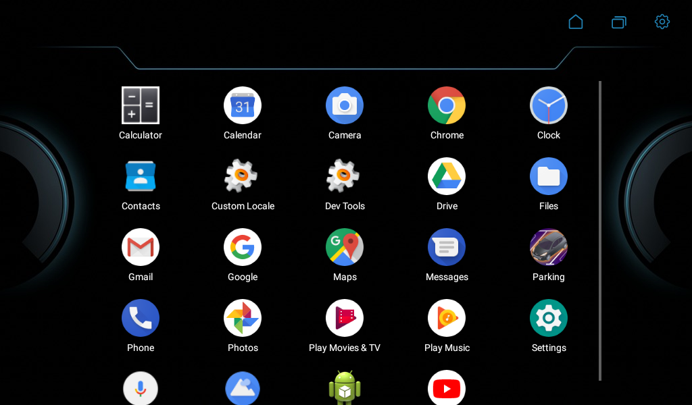
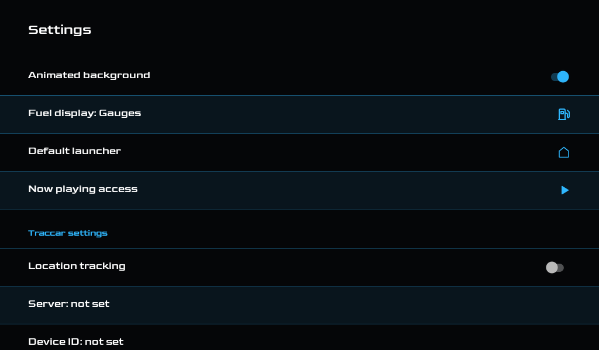

# Dashboard

A custom home-screen launcher for the Teyes CC2 head unit in a Peugeot 207, replacing the stock
Teyes launcher. It is styled after the Peugeot i-Cockpit cluster: a black background with cyan
gauge arcs, the silver Peugeot logo, a clock, the weather, and large shortcuts that are
easy to hit while driving.

**New here?** The [setup guide](docs/SETUP.md) covers installing it, location tracking with
Traccar, building your own APK and custom shortcuts.



### Trip computer

Tap the fuel consumption for trip 1, now and trip 2, the same pages the car's display shows.



### App drawer and settings

Tap the clock for every installed app; the gear opens Settings (optionally behind a PIN).





## Features

- **Shortcuts:** front view camera, radio, Spotify, Traccar and Waze, plus optionally a
  parking app of your choice;
  which ones and their order are set by `shortcuts` in `android/defaults.properties`.
- **Clock** in Orbitron and **date** in Goldman, updated by the system with no timers of our own.
- **Weather** under the date: now and about 3, 6 and 9 hours ahead for where the car is
  (Open-Meteo, no API key). Android asks for location access once.
- **Now playing:** artist and track for Spotify (or whatever is playing). While a song plays,
  previous and next buttons appear on either side of the weather.
  Needs notification access once: Settings → **Now playing access**.
- **Status corner** (top right): outside temperature, a location pin while tracking is on
  (it flashes cyan each time positions reach the server), the connection type as on a phone (4G,
  H+, H, 3G, E, G or Wi-Fi) with signal bars, and the volume (tap it for the volume slider),
  all updating live, since the fullscreen home screen hides the Teyes status bar. The
  temperature is the car's own sensor (thermometer icon) when the Teyes CAN box reports one,
  otherwise the forecast; at 3° and below it turns ice blue with a snowflake.
- **Fuel consumption** from the car's trip computer (Teyes CAN box): the instant consumption
  and the range on either side of the clock, or just the instant consumption in the status
  corner, or off (Settings → **Fuel display**). While the car stands it reads "--.-", as on the
  car's own display. Tap it for the **trip computer**: trip 1, now and trip 2 (distance,
  average consumption and speed; consumption, range and distance to destination), the same
  pages the car's display shows.
- **Volume on the arcs:** tap the left gauge arc to turn the volume down, the right one to
  turn it up; hold to keep going. The zones are wide (from the edge in to the clock, down to
  the line over the shortcuts), so they are easy to hit while driving.
- **Logo:** tap the Peugeot logo to play or pause the music.
- **Clock:** tap it to open the app drawer.
- **Weather:** tap it to send the car's position to Traccar right away.
- **App drawer:** tap the clock (or long-press outside the shortcut bar) to see every installed app,
  swipe down to close it. It sits on its own matching background. Top right: home, recent
  apps and settings. The recent apps button needs a one-time switch in Android's
  accessibility settings ("Dashboard recent apps button"); the button takes you there.
- **Animated background:** when the home screen appears, the cyan lines light up from the
  centre and a faint hexagon texture spreads out from the logo over 2 seconds; then the lines
  slowly breathe (4-second cycle). It runs only while the home screen is visible and can be
  turned off in Settings.
- **Settings:** the gear at the top right of the app drawer, behind a PIN (so a garage can't
  change tracking or the home point). Turn the animation on or off,
  choose the fuel display, grant now playing access, pick a different default launcher, and set
  up location tracking and the home point (below).
- **Location tracking:** sends the car's position every 5 seconds to the Traccar server
  (OsmAnd protocol, same device id as Traccar Client, so Traccar Client is no longer needed).
  Positions that can't be sent wait on the head unit and go out once it's back online. It
  starts by itself whenever the home screen shows, so it survives the head unit's sleep.
  Settings: on/off, server address, device id. Step by step:
  [setup guide](docs/SETUP.md#2-location-tracking-with-traccar).
- **Parking app on arrival** (optional, with `parking.package` and `parking.onArrival=true`
  in `android/defaults.properties`; otherwise these settings are hidden): driving into the
  home radius (default 350 m) below 15 km/h opens that app once. It only triggers again after
  leaving the radius by 200 m more. Home point and radius are in Settings.
- **Light:** besides the GPS service above, nothing runs while another app is in front,
  because the head unit's SoC is weak.

## Target device

| | |
|---|---|
| Head unit | Teyes CC2 |
| Android | 8.1 (API 27), x86 |
| Screen | 1024x600, 160 dpi, landscape |

## Install

Download the latest APK from the
[releases](../../releases), install it on the head unit,
then press Home. Android asks which launcher to use:

- Pick **Dashboard → Just once** to try it. The next Home press asks again.
- Pick **Dashboard → Always** to make it the default.

## Going back to the stock launcher

Any of these works; the stock Teyes launcher is never removed, only unselected.

1. **From Dashboard:** long-press an empty spot, tap the gear at the top right (enter the PIN), then
   **Default launcher**, and pick the Teyes launcher.
2. **From Android settings:** Settings → Apps & notifications → Advanced → Default apps → Home
   app.
3. **Uninstall Dashboard:** Settings → Apps → Dashboard → Uninstall. Android falls back to the
   stock launcher.
4. **Over adb**, if USB or Wi-Fi debugging is on: `adb uninstall com.izosa.home.car.dashboard`.

## Shortcut packages

| Shortcut | Package |
|---|---|
| Front view | `com.syu.frontvideo` |
| Radio | `com.syu.radio` |
| Spotify | `com.spotify.music` |
| Traccar | `org.traccar.client` |
| Waze | `com.waze` |

They are defined in `android/app/src/main/res/values/strings.xml`. A missing app shows a
"not installed" message instead of crashing.

## Build

Requires JDK 17+ (Android Studio's bundled `jbr` works) and the Android SDK with platform 35.
Create `android/local.properties` with `sdk.dir=<path to Android SDK>`.
Personal defaults (tracking server, device id, home point, Settings PIN) go in
`android/defaults.properties`, which is gitignored: copy
[`android/defaults.properties.example`](android/defaults.properties.example) and fill it in.
Without it the app builds with tracking off, no home point and no PIN. The
[setup guide](docs/SETUP.md#3-building-your-own-apk) lists every key and shows how to
[add your own shortcuts](docs/SETUP.md#4-custom-shortcuts).

```bash
cd android
./gradlew assembleRelease
adb install -r app/build/outputs/apk/release/app-release.apk
```

Release builds are signed with the debug keystore.

## Emulator

An AVD named `car` mimics the head unit: Android 8.1 Google APIs x86, 1024x600 at 160 dpi,
landscape. The head unit draws text at about 1.3x, which `adb shell settings put system
font_scale 1.3` reproduces.

```bash
emulator -avd car
```

The front camera app only exists on the real Teyes, so that shortcut can't be tested in the
emulator. Neither does the Teyes `com.syu.ms` service that reports the car's outside
temperature and trip computer, so the emulator shows the forecast and no fuel figures; the
README screenshots were taken with a small stand-in app installed as `com.syu.ms` that reports
the values seen in the car.

## Design files

`design/` holds the source artwork:

- `peugeot_logo_line.svg`, converted to the vector drawable `ic_peugeot_logo.xml`
- `background_1_sharp.png`, `background_2_rounded.png` (home screen) and `background_3_low.png`
- `background_drawer.jpg`, the app drawer background
- `split_glow.py`, which splits a background into the three animated layers (dimmed base,
  hexagon texture, cyan glow): `python split_glow.py background_2_rounded.png
  <res>/bg_dashboard.jpg <res>/bg_dashboard_texture.png <res>/bg_dashboard_glow.png`
- `make_mockups.py`, which warps `screenshots/home.png` onto photos of the car (the photos
  and the mockups stay out of git)

## Fonts

Goldman for the labels and Orbitron SemiBold for the clock, both from Google Fonts under the
SIL Open Font License ([`licenses/Goldman-OFL.txt`](licenses/Goldman-OFL.txt),
[`licenses/Orbitron-OFL.txt`](licenses/Orbitron-OFL.txt)).

Unofficial project, not affiliated with Peugeot or Teyes; Peugeot and its lion logo are
trademarks of their owner.

## License

Code under the [MIT License](LICENSE). The fonts keep their own
licences, listed in [`licenses/`](licenses/).
